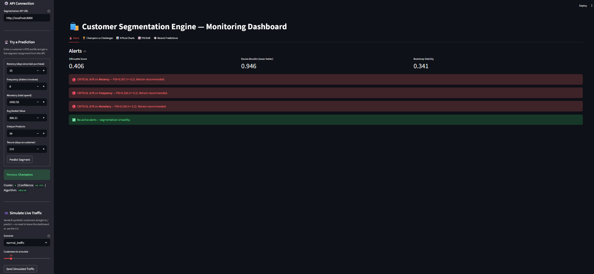
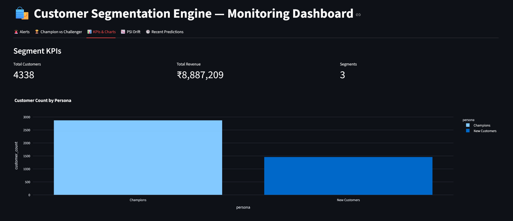
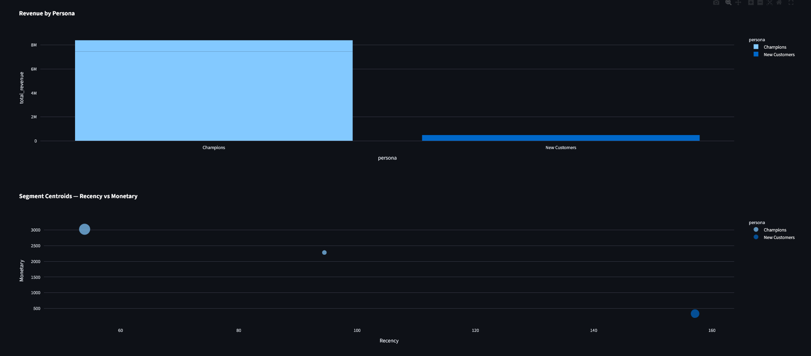
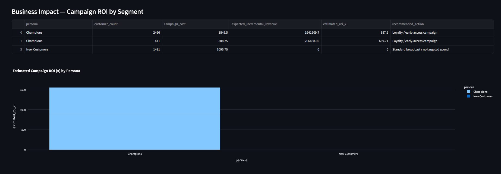
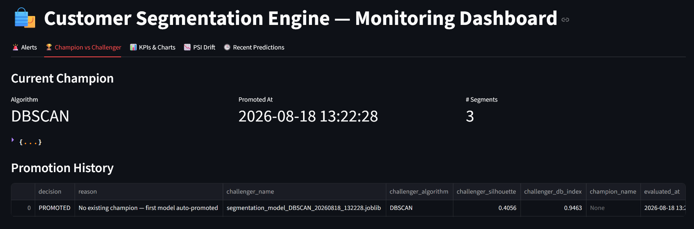
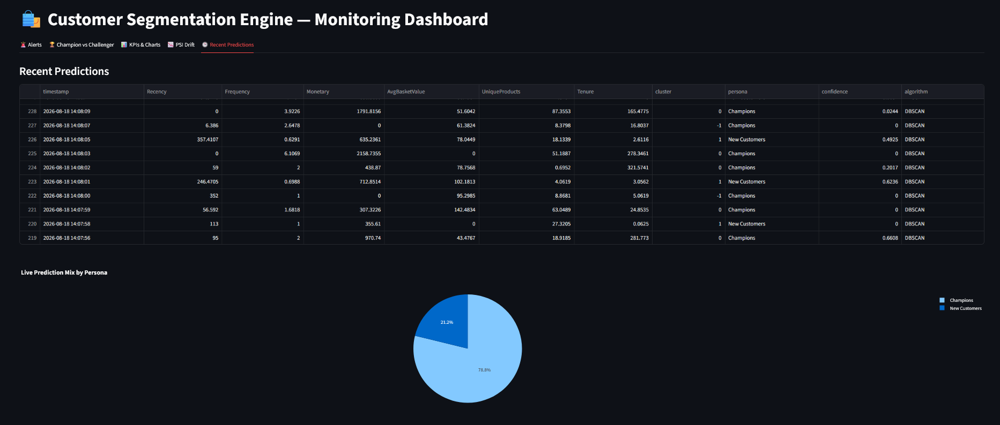
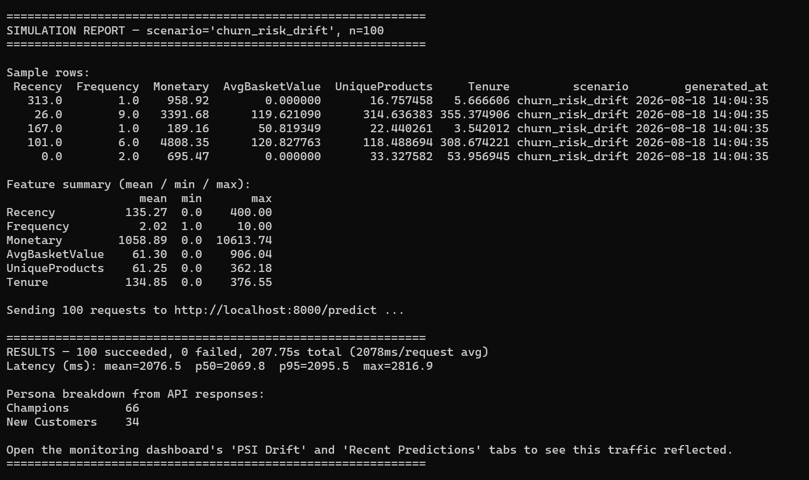
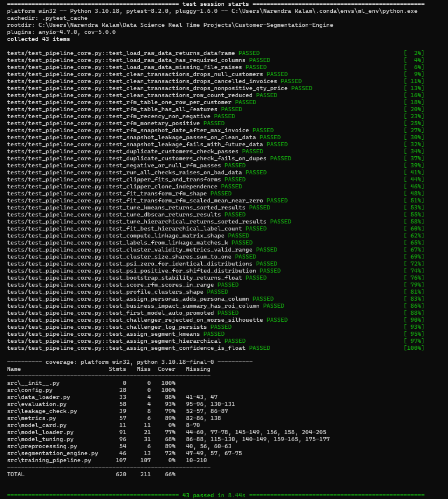

# 🛍️ Customer Segmentation Engine — RFM Clustering for Targeted Marketing

[](https://github.com/narendrakalam2001/Customer-Segmentation-Engine/actions)
[](https://python.org)
[](https://scikit-learn.org)
[](https://fastapi.tiangolo.com)
[](https://streamlit.io)
[](https://scikit-learn.org/stable/modules/clustering.html#dbscan)
[](https://docker.com)
[](tests/test_pipeline_core.py)
[](LICENSE)

> **Domain:** E-Commerce / BFSI / Consulting
> **Problem:** Unsupervised Clustering — segment customers with no ground-truth label to score against
> **Dataset:** [UK Online Retail (Kaggle)](https://www.kaggle.com/datasets/carrie1/ecommerce-data) — 541,909 transactions · 4,338 customers after cleaning
> **Industry Context:** E-commerce, BFSI and consulting growth teams — RFM segmentation turns "one email to everyone" into targeted, persona-specific campaigns

---

## 💡 Why This Project Matters

Retail and BFSI growth teams don't blast every customer with the same offer — they segment first, then target. This project reproduces that workflow end-to-end, adapted for a genuinely **unsupervised** problem (unlike the portfolio's supervised Fraud/Credit-Risk/Churn systems, there's no ground-truth label here):

- **RFM feature engineering** (Recency, Frequency, Monetary + 3 behavioral features) converts a raw transaction log into one row per customer
- A **4-algorithm model search** (KMeans, DBSCAN, Hierarchical/Agglomerative with dendrogram, GMM) is ranked by internal validity indices (Silhouette, Davies-Bouldin, Calinski-Harabasz) since there's nothing to compute F1/ROC-AUC against
- A **business usability gate** rejects any config whose smallest segment is under 3% of customers — a mathematically "best" split that produces a 1% micro-segment is useless for a real campaign
- Every retrain goes through a **3-gate Champion-Challenger** check adapted for clustering, with versioned model files so a rejected challenger can never silently overwrite the champion
- Each segment is translated into an estimated **campaign ROI** — the same cost-sensitive-evaluation philosophy the portfolio's Fraud/Credit-Risk projects use, adapted from loss-avoidance to marketing spend

---

## 🏆 Champion Model Results

*(Trained on the full 541,909-row dataset → 4,338 customers after cleaning)*

| Metric | Score |
|---|---|
| **Champion Algorithm** | `DBSCAN (eps=0.7, min_samples=10)` |
| **Silhouette Score** | `0.4056` |
| **Davies-Bouldin Index** | `0.9463` (lower is better) |
| **Calinski-Harabasz Index** | `3,428.31` |
| **Clusters Found** | `2` (+ 9.47% noise, unassigned) |
| **Bootstrap Stability** | `0.3406` mean silhouette (10 resamples) |
| **Total Customers Segmented** | `4,338` |
| **Total Revenue Segmented** | `₹8,887,209` |
| **Algorithms Compared** | `58 configs across KMeans/DBSCAN/Hierarchical/GMM` |

Full leaderboard is written to `segmentation_models/model_experiment_results.csv` on every training run.

---

## 🔗 Live Links

| Service | URL |
|---|---|
| 🚀 **FastAPI (Swagger UI)** | [https://customer-segmentation-engine-4njy.onrender.com/docs](https://customer-segmentation-engine-4njy.onrender.com/docs) |
| 📊 **Monitoring Dashboard** | [https://customer-segmentation-engine-dashboard.streamlit.app](https://customer-segmentation-engine-dashboard.streamlit.app) |
| 📓 **EDA Notebook** | [notebooks/customer_segmentation_eda.ipynb](notebooks/customer_segmentation_eda.ipynb) |

> ⚠️ Render free tier: first request may take 30–60 seconds (cold start).

---

## 🏗️ System Architecture


```
╔══════════════════════════════════════════════════════════════════════════════════╗
║           CUSTOMER SEGMENTATION ENGINE — 5-LAYER PRODUCTION SYSTEM               ║
╠══════════════════════════════════════════════════════════════════════════════════╣
║                                                                                  ║
║  ┌─────────────────────────────── DATA LAYER ──────────────────────────────┐     ║
║  │ Online Retail CSV → Clean Transactions → RFM Engineering → Leakage Check│     ║
║  │ 541,909 txns · 4,338 customers · Clipper(IQR) → Yeo-Johnson → Scaler    │     ║
║  └───────────────────────────────────┬─────────────────────────────────────┘     ║
║                                      ▼                                           ║
║  ┌─────────────────────────── MODEL SEARCH PIPELINE ───────────────────────┐     ║
║  │                                                                         │     ║
║  │  ┌──────────────┐  ┌──────────────┐  ┌──────────────┐  ┌────────────┐   │     ║
║  │  │  KMeans      │  │  DBSCAN      │  │  Hierarchical│  │  GMM       │   │     ║
║  │  │  k=2..10     │  │  eps×min_samp│  │  +dendrogram │  │  soft-clust│   │     ║
║  │  └──────────────┘  └──────────────┘  └──────────────┘  └────────────┘   │     ║
║  │                                                                         │     ║
║  │  Business Gate: min segment ≥ 3% of customers → 58 configs evaluated    │     ║
║  │                                                                         │     ║
║  │  CHAMPION → DBSCAN  Silhouette=0.4056  Davies-Bouldin=0.9463            │     ║
║  └───────────────────────────────────┬─────────────────────────────────────┘     ║
║                                      ▼                                           ║
║  ┌──────────────────────── CHAMPION-CHALLENGER ────────────────────────────┐     ║
║  │                                                                         │     ║
║  │  Gate 1: Silhouette improvement  ≥ 0.01   →  ✅ PASS / ❌ FAIL         │     ║
║  │  Gate 2: Davies-Bouldin index    ≤ 1.20   →  ✅ PASS / ❌ FAIL         │     ║
║  │  Gate 3: min segment share       ≥ 3%     →  ✅ PASS / ❌ FAIL         │     ║
║  │                                                                         │     ║
║  │  ALL gates pass → PROMOTED (latest_model.json updated, timestamped)     │     ║
║  │  ANY gate fails → REJECTED (champion retained, challenger files purged) │     ║
║  └───────────────────────────────────┬─────────────────────────────────────┘     ║
║                                      ▼                                           ║
║  ┌──────────────────────────── SERVING LAYER ──────────────────────────────┐     ║
║  │                                                                         │     ║
║  │  Model Loader → Segmentation Engine → Prediction Service → FastAPI      │     ║
║  │                                                                         │     ║
║  │  POST /predict     → RFM values      (→ cluster + persona + confidence) │     ║
║  │  GET  /health       → API health check (→ {status, service})            │     ║
║  │  GET  /model_info   → champion model card (→ metrics + personas)        │     ║
║  └───────────────────────────────────┬─────────────────────────────────────┘     ║
║                                      ▼                                           ║
║  ┌─────────────────── MONITORING LAYER — STREAMLIT DASHBOARD ──────────────┐     ║
║  │                                                                         │     ║
║  │  Tab 1: Real-Time Alerts    → noise-ratio · min-share · PSI critical    │     ║
║  │  Tab 2: Champion-Challenger → decision · 3-gate status · full history   │     ║
║  │  Tab 3: KPIs + Charts       → revenue/count by persona · ROI · dendro   │     ║
║  │  Tab 4: PSI Drift           → per-RFM-feature PSI vs training reference │     ║
║  │  Tab 5: Recent Predictions  → audit log · live persona mix pie chart    │     ║
║  │  Sidebar: Try a Prediction  → manual RFM form → instant persona         │     ║
║  │  Sidebar: Simulate Traffic  → 3 scenarios, bootstrapped from real RFM   │     ║
║  └─────────────────────────────────────────────────────────────────────────┘     ║
╚══════════════════════════════════════════════════════════════════════════════════╝
```

---

## 📸 Dashboard Screenshots

### 🖥️ Full Dashboard UI

Real-time segmentation monitoring — sidebar live prediction + traffic simulation · Champion-Challenger system · KPI cards · PSI drift · prediction audit log.



---

### 📊 Segment KPIs

Total customers, total revenue segmented, and segment count at a glance, with customer-count-by-persona bar chart.



---

### 💰 Revenue & Segment Centroids

Revenue by persona alongside an RFM centroid scatter (Recency vs Monetary, bubble size = segment size) for a quick visual read on where value concentrates.



---

### 📈 Business Impact / Campaign ROI

Estimated campaign cost, expected incremental revenue, and ROI multiple per persona — the "so what" layer for a marketing stakeholder demo.



---

### 🏆 Champion vs Challenger — Promotion History

Current champion card plus the full promotion history table with per-gate outcomes for every retrain.



---

### 📉 Feature Drift (PSI) Monitoring

Per-RFM-feature Population Stability Index vs the training reference distribution — colour-coded: green stable · orange moderate · red critical retrain.


---

### 📋 Recent Predictions Log

Last 50 `/predict` calls with cluster, persona, and confidence, plus a live persona-mix pie chart.



---

## 📊 Training Reports

| Training & Evaluation Summary | Live Traffic Simulation |
|---|---|
|  |  |

| Test Coverage |
|---|
|  |

---

## 🎬 System Demo


---

## 📁 Project Structure

```
Customer-Segmentation-Engine/
│
├── src/                                    # Core ML system
│   ├── config.py                           # thresholds, gates, paths
│   ├── data_loader.py                      # load + clean transaction log
│   ├── preprocessing.py                    # Clipper, RFM engineering, scaling pipeline
│   ├── model_tuning.py                     # KMeans / DBSCAN / Hierarchical / GMM grid search
│   ├── metrics.py                          # Silhouette, DB, CH, PSI, bootstrap stability
│   ├── evaluation.py                       # cluster profiling, persona naming, business impact
│   ├── leakage_check.py                    # snapshot/duplicate/null leakage checks
│   ├── model_loader.py                     # Champion-Challenger 3-gate promotion system
│   ├── model_card.py                       # Google Model Cards standard JSON
│   ├── segmentation_engine.py              # inference: assign new customer to segment
│   └── training_pipeline.py                # orchestrates the full pipeline
│
├── serving/
│   └── segmentation_api.py                 # FastAPI: /predict · /health · /model_info
│
├── services/
│   └── prediction_service.py               # caching + prediction logging
│
├── monitoring/
│   ├── monitoring_dashboard.py             # Streamlit — 5 tabs + sidebar prediction/simulation
│   └── requirements.txt                    # lightweight deps — auto-detected by Streamlit Cloud
│
├── simulation/
│   └── customer_simulator.py               # 3 scenarios, bootstrapped from real RFM distribution
│
├── tests/
│   ├── conftest.py                         # OMP_NUM_THREADS fix for sklearn/Windows
│   ├── fixtures/                           # synthetic sample_retail.csv for CI
│   └── test_pipeline_core.py               # 43 pytest unit tests — all passing
│
├── scripts/
│   ├── train_model.py                      # python scripts/train_model.py
│   ├── run_api.py                          # python scripts/run_api.py
│   ├── run_dashboard.py                    # python scripts/run_dashboard.py
│   └── run_simulation.py                   # python scripts/run_simulation.py --scenario churn_risk_drift --n 100 --send-api
│
├── notebooks/
│   ├── customer_segmentation_eda.ipynb              # Professional EDA — 27 steps · dendrogram
│   └── customer_segmentation_eda.html
│
├── data/
│   ├── raw/
│   │    └── README.md                      
│   └── sample_online_retail.csv            # sample dataset — a working demo is possible without Kaggle
│
│
├── segmentation_models/                    # Model artifacts — pushed to GitHub, required by Render/Streamlit
│   ├── latest_model.json                   # Champion model registry
│   ├── challenger_log.json                 # Full Champion-Challenger comparison history
│   ├── model_card_*.json                   # Google Model Card JSON
│   ├── *.joblib                            # the champion model itself
│   ├── model_experiment_results.csv        # every config from every run
│   ├── cluster_profile.csv                 # per-cluster RFM means + persona
│   ├── business_impact.csv                 # campaign ROI per persona
│   ├── reference_rfm_distribution.csv      # baseline for PSI drift + simulator bootstrap
│   └── dendrogram.png                      # only present if Hierarchical won
│
├── docs/
│   ├── architecture/
│   │   └── system_architecture.svg         # 5-layer system architecture diagram
│   ├── screenshots/
│   │   ├── dashboard_full_ui.png
│   │   ├── segment_kpis.png
│   │   ├── revenue_and_segment_centroids.png
│   │   ├── business_impact.png
│   │   ├── current_champion_promotion_history.png
│   │   ├── feature_drift(psi).png
│   │   └── recent_predictions.png
│   ├── reports/
│   │   ├── training_model_summary.png
│   │   ├── simulation.png
│   │   └── test_coverage.png
│   └── gifs/
│       └── system_demo.gif
│
├── logs/
│   └── prediction_logs.csv                 # API prediction audit log (auto-generated)
│
├── Dockerfile                               # FastAPI production image
├── Dockerfile.dashboard                     # Streamlit dashboard container
├── docker-compose.yml                       # API + Dashboard (ports 8000 + 8501)
├── .github/workflows/ci.yml                # GitHub Actions — pytest on every push
├── .gitignore
├── LICENSE                                  # MIT License
├── README.md                                # This file
├── render.yaml                              # Render.com deployment config
├── requirements.txt                         # full dev/training dependencies
├── requirements_api.txt                     # lightweight API-only dependencies
├── requirements_dashboard.txt                # dashboard deps (Docker build uses this copy)
└── runtime.txt                              # Python version pin
```

---

## 🚀 Quickstart

### 1. Clone & Install

```bash
git clone https://github.com/narendrakalam2001/Customer-Segmentation-Engine.git
cd Customer-Segmentation-Engine
pip install -r requirements.txt
```

### 2. Dataset

```
data/
├── raw
└── sample_online_retail.csv     ← sample dataset already included for a quick smoke-test run
```

For real, reproducible metrics, download [Online Retail](https://www.kaggle.com/datasets/carrie1/ecommerce-data) from Kaggle and replace `data/sample_online_retail.csv` with the full 541,909-row file.

### 3. Train Model

```bash
python scripts/train_model.py
```

Expected output:
```
INFO  Raw data loaded: 541909 rows, 8 columns
INFO  Cleaning: 541909 -> 392692 rows retained (72.5%), 4338 unique customers
INFO  All 3 leakage checks PASSED
INFO  Full search complete: 58 configs evaluated across 4 algorithms
INFO  Best algorithm selected: DBSCAN (eps=0.7, min_samples=10)
INFO  Bootstrap stability (10 iters): mean silhouette=0.3406
TRAINING PIPELINE COMPLETE — decision: PROMOTED
```

### 4. Start API

```bash
python scripts/run_api.py
# API:  http://localhost:8000
# Docs: http://localhost:8000/docs
```

### 5. Start Dashboard

```bash
python scripts/run_dashboard.py
# Dashboard: http://localhost:8501
```
The sidebar has a **manual prediction form** (test a customer instantly) and a **"Simulate Live Traffic"** button — no CLI needed to demo the full loop.

### 6. Run Simulation

```bash
python scripts/run_simulation.py --scenario normal_traffic    --n 50  --send-api
python scripts/run_simulation.py --scenario high_value_surge  --n 50  --send-api
python scripts/run_simulation.py --scenario churn_risk_drift  --n 100 --send-api
```

### 7. Run Tests

```bash
pytest tests/ -v --cov=src --cov-report=term-missing
# 43 collected · 43 passed · 0 failed
```

---

## 🐳 Docker

```bash
# Start everything
docker compose up --build

# API only
docker compose up api

# Dashboard only
docker compose up dashboard

# Stop
docker compose down
```

| Service | URL |
|---|---|
| FastAPI + Swagger | `http://localhost:8000/docs` |
| Streamlit Dashboard | `http://localhost:8501` |

---

## 🌐 API Reference

### POST /predict — Assign a Customer's Segment

```bash
curl -X POST "http://localhost:8000/predict" \
  -H "Content-Type: application/json" \
  -d '{
    "Recency": 12,
    "Frequency": 8,
    "Monetary": 2450.50,
    "AvgBasketValue": 306.31,
    "UniqueProducts": 34,
    "Tenure": 210
  }'
```

**Response:**
```json
{
  "cluster": 0,
  "persona": "Champions",
  "confidence": 0.87,
  "algorithm": "DBSCAN"
}
```

### GET /health

```json
{"status": "ok", "service": "customer-segmentation-engine"}
```

### GET /model_info

```json
{
  "algorithm": "DBSCAN",
  "model_name": "segmentation_model_DBSCAN_20260818_132228.joblib",
  "promoted_at": "2026-08-18 13:22:28",
  "n_segments": 3,
  "personas": ["Champions", "New Customers"],
  "features_required": ["Recency", "Frequency", "Monetary", "AvgBasketValue", "UniqueProducts", "Tenure"]
}
```

---

## 📊 All 4 Algorithms — Comparison

| Algorithm | Search Space | Silhouette | Davies-Bouldin | Notes |
|---|---|---|---|---|
| **DBSCAN** ⭐ | eps × min_samples grid | **0.4056** | **0.9463** | Champion — handles noise, no fixed k needed |
| KMeans | k = 2..10 | 0.3811 | 1.0395 | Strong, interpretable baseline (k=2) |
| Hierarchical (average) | ward / average / complete | 0.3718 | 1.0377 | Adds a dendrogram for visual k sanity-check |
| GMM | k = 2..8 | — | — | Soft-clustering challenger, logged every run |

> DBSCAN won on Silhouette, but flags ~9.5% of customers as noise (unassigned) — see **Known Limitations** below before treating noise-cluster customers as a real target segment.

---

## 🏆 Champion vs Challenger — 3-Gate Promotion

Every new training run is compared against the production champion using **3 promotion gates**, adapted for unsupervised clustering (no ground-truth label to score F1/ROC-AUC against):

| Gate | Condition | Rationale |
|---|---|---|
| Silhouette Improvement | Challenger must beat champion by ≥ 0.01 | Meaningful separation gain only |
| Davies-Bouldin Index | ≤ 1.20 | Tight, well-separated clusters |
| Minimum Segment Size | smallest segment ≥ 3% of customers | No unusable micro-segments in production |

> **Why strict gates?** A segmentation model promoted with a worse or more fragmented split than the
> champion could silently break a live marketing campaign — the 3-gate system ensures any new
> algorithm or hyperparameter change is demonstrably better, on metrics that actually matter for
> targeting, before going live.

**Real run — rejected retrain (identical data, no improvement):**

```
CHAMPION vs CHALLENGER
  Champion  : segmentation_model_DBSCAN_v1.joblib             sil=0.4056  DB=0.9463
  Challenger: segmentation_model_DBSCAN_20260818_131447.joblib sil=0.4056  DB=0.9463
CHALLENGER REJECTED — champion retained
   Reason: Gates failed: silhouette improvement +0.0000 < 0.01
```

Rejected challengers' `.joblib`/model-card files are deleted automatically to keep `segmentation_models/` clean — only the champion and its full metrics history persist. Results logged to `segmentation_models/challenger_log.json` and visible in the dashboard's Champion vs Challenger tab.

---

## 💰 Business Impact — Campaign ROI by Segment

*(From an actual run on the full dataset — `segmentation_models/business_impact.csv`)*

| Persona | Customers | Campaign Cost | Expected Incremental Revenue | ROI | Action |
|---|---|---|---|---|---|
| Champions | 2,466 | ₹1,849.50 | ₹1,641,609.70 | **887.6x** | Loyalty / early-access campaign |
| Champions (secondary cluster) | 411 | ₹308.25 | ₹206,438.95 | 669.7x | Loyalty / early-access campaign |
| New Customers | 1,461 | ₹1,095.75 | ₹0 | 0x | Standard broadcast / no targeted spend |

---

## 📈 Monitoring Dashboard — 5 Sections

| Section | What it shows |
|---|---|
| **1. Real-Time Alerts** | Silhouette/DB/stability metrics · noise-ratio > 15% · segment share < 3% · PSI critical drift |
| **2. Champion-Challenger** | Latest decision badge · 3-gate status · full promotion history table |
| **3. KPIs + Charts** | Customer count & revenue by persona · RFM centroid scatter · campaign ROI table · dendrogram (when Hierarchical is champion) |
| **4. PSI Drift** | Per-RFM-feature PSI vs training reference, colour-coded bar |
| **5. Recent Predictions** | Last 50 API calls · cluster · persona · confidence · live persona-mix pie chart |
| **Sidebar** | Try a Prediction (manual RFM form) + Simulate Live Traffic (3 scenarios, no CLI needed) |

---

## 🧪 Test Coverage

```
43 tests collected across pipeline stages:

  Data Loader                7  — raw load · required columns · missing file ·
                                  drop nulls/cancellations/non-positive qty·price · row count reduced
  RFM Engineering             5  — one row per customer · all features present ·
                                  recency non-negative · monetary positive · snapshot after max invoice
  Leakage Checks              6  — snapshot leakage pass/fail · duplicate customers pass/fail ·
                                  negative/null RFM · run_all_checks raises on bad data
  Preprocessing                4  — Clipper fit/transform · clone independence ·
                                  fit_transform shape · scaled mean near zero
  Model Tuning & Metrics      11  — KMeans/DBSCAN/Hierarchical search · linkage matrix ·
                                  fcluster labels · validity metrics range · cluster shares ·
                                  PSI zero/positive · bootstrap stability
  Evaluation                   4  — RFM quantile scores · cluster profiling · persona
                                  assignment · business impact ROI columns
  Champion-Challenger          3  — first model auto-promoted · rejected on worse silhouette ·
                                  challenger log persists
  Segmentation Engine          3  — KMeans inference · Hierarchical inference (nearest-centroid) ·
                                  confidence is a float

Result: 43 passed · 0 failed
```


`tests/conftest.py` sets `OMP_NUM_THREADS=1` before scikit-learn loads, per scikit-learn's own recommendation — avoids a known KMeans/MKL memory-leak warning on Windows.

---

## 🧠 Technical Standards

| Component | Implementation |
|---|---|
| **RFM Engineering** | Fixed `snapshot_date` (max invoice + 1 day) → Recency/Frequency/Monetary + AvgBasketValue/UniqueProducts/Tenure |
| **Outlier Handling** | `Clipper` (IQR, fold=1.5) — fit on train, applied at inference |
| **Scaling** | Yeo-Johnson power transform → StandardScaler (`clone()` per run, no shared fitted state) |
| **Model Search** | KMeans (k=2-10) · DBSCAN (eps×min_samples grid) · Hierarchical (ward/average/complete + dendrogram) · GMM — 58 configs ranked by Silhouette |
| **Business Usability Gate** | Best-silhouette config only wins if its smallest segment ≥ 3% of customers |
| **Champion-Challenger** | 3-gate: Silhouette improvement ≥0.01 · Davies-Bouldin ≤1.20 · min segment share ≥3% — timestamped model files, rejected challengers can never overwrite the champion |
| **Drift Monitoring** | Edge-based PSI per RFM feature — live traffic bootstrapped from the real training distribution vs training reference |
| **Leakage Detection** | Snapshot leakage · duplicate-customer leakage · null/negative-value checks — run before every training call |
| **Explainability** | Model Card JSON (Google Model Cards standard) · persona rule engine documented in `src/evaluation.py` |
| **Experiment Tracking** | `segmentation_models/model_experiment_results.csv` — every config from every run, MLflow-ready |
| **CI/CD** | GitHub Actions — pytest on every push · coverage report |
| **Deployment** | Render.com (FastAPI) + Streamlit Cloud (Dashboard) |

---

## ⚠️ Known Limitations & Practical Considerations

- **DBSCAN noise persona edge case**: the current champion is DBSCAN, and ~9.5% of customers fall into the noise cluster (label `-1`). At inference, `segmentation_engine.py` is designed to label these as `"Unclassified"` — but the persona rule engine in `evaluation.py` runs on *all* cluster rows produced at training time, including the noise cluster's centroid, which can assign it a real persona label (e.g. "Champions") instead. This means the "9.5% of customers get Unclassified" guarantee mentioned during training doesn't fully hold today — worth a follow-up fix (special-case cluster `-1` in `assign_personas()`) before treating noise-cluster customers as a real target segment in a live campaign.
- **Small-sample PSI sensitivity**: PSI values can look inflated on very small customer bases (the bundled CI fixture has only 120 synthetic customers) — this is a known quantile-binning artifact, not a bug; it settles down at the real dataset's scale (4,338 customers).
- **AgglomerativeClustering has no native `.predict()`**: new customers are assigned via nearest-centroid to precomputed cluster means, not the algorithm's original linkage — a standard, documented workaround, but worth knowing if you inspect `segmentation_engine.py`.
- **Clusters are not stable across retrains**: cluster IDs (0, 1, 2...) can be reassigned on every retrain since this is unsupervised — personas are re-derived from RFM rules each time rather than relying on a fixed label mapping, but any downstream system caching a raw `cluster` ID (instead of the `persona` string) should re-fetch after every promotion.

---

## 👨‍💻 About

**Narendra Kalam** — MSc Computer Science (Gold Medalist — NASSCOM, Full Stack Data Science + AI)

> Building 30+ industry-level, end-to-end ML systems across all domains.

[](https://www.linkedin.com/in/narendra-kalam)
[](https://www.kaggle.com/narendrakalam)
[](https://narendrakalam2001.github.io)
[](mailto:kalamnarendra2001@gmail.com)

### Portfolio Projects

| # | Project | Domain | Champion Model | Key Metric |
|---|---|---|---|---|
| 1 | Credit Card Fraud Detection | BFSI / Fintech | ExtraTrees | F1 = 0.8962 · 284K transactions |
| 2 | Credit Risk Prediction | BFSI / Lending | LightGBM | F1 = 0.9741 · ROC-AUC = 0.9991 |
| 3 | Customer Churn Prediction | Telecom / BFSI | CatBoost | F1 = 0.634 · Recall = 0.7312 |
| 4 | House Price Prediction | Real Estate | CatBoost | RMSE = $20,128 · R² = 0.9053 |
| 5 | Store Sales Forecasting | Retail / Supply Chain | LightGBM (Ensemble) | RMSLE = 0.3739 · R² = 0.9761 |
| 6 | Energy Demand Forecasting | Energy / Utilities | ElasticNet | RMSE = 712.04 MW · R² = 0.9759 |
| 7 | Stock Price & Risk Forecasting | Fintech / Capital Markets | Ridge | DirAcc = 53.44% · Sharpe = 0.80 |
| 8 | Resume Screener AI | HR Tech | LightGBM | F1 = 0.7608 · Top-3 = 0.9416 |
| 9 | ABSA Sentiment Analysis | E-Commerce / Banking | RidgeClassifier | Macro-F1 = 0.6212 · ROC-AUC = 0.823 |
| 10 | Fake News Detector | Media Tech / Gov Tech | XGBoost | F1 = 0.9993 · ROC = 1.0000 |
| 11 | BC5CDR Clinical NER | Biomedical NLP | BioBERT | F1 = 0.8847 · Chemical F1 = 0.9239 |
| 12 | News Topic Modeling | Media Analytics | LDA (Gensim) | Cv = 0.6225 · Diversity = 0.92 |
| 13 | Chest X-Ray Diagnosis | Healthcare AI | DenseNet121 | Mean AUC = 0.7864 · 14 classes |
| 14 | Real-Time Object Detection | Computer Vision / Retail-Security | YOLOv8s | mAP50-95 = 0.5341 · 32 FPS |
| 15 | Face Emotion Recognition | EdTech / Retail CX | CNN-from-scratch | Macro-F1 = 0.5950 · 7 classes |
| 16 | **Customer Segmentation Engine** | **E-Commerce / BFSI** | **DBSCAN (Unsupervised)** | **Silhouette = 0.4056** |
| 17 | Market Basket Analysis (Instacart) | Retail / Quick-Commerce | Apriori | 68,820 rules · mean lift = 15.66 |
| 18 | E-Commerce / OTT Recommender | E-Commerce / Streaming | Hybrid (SVD + Content) | NDCG@10 = 0.0407 · 4 candidates |
| 19 | Hospital Readmission Prediction | Healthcare / Hospital Ops | ExtraTrees | F1 = 0.2702 · ROC-AUC = 0.6513 |
| 20 | HR Policy Intelligence Chatbot | HR Tech / Enterprise GenAI | Gemini 3.6 Flash + RAG | 30/30 tests · guardrail threshold=0.35 |
| 21 | Employee Attrition Prediction | HR Tech / People Analytics | NeuralNet (MLP) | F1 = 0.3902 · ROC-AUC = 0.6698 |
| 22 | ANN From Scratch — MNIST Digit Recognizer | Deep Learning Fundamentals | From-scratch ANN | Test Acc = 0.9740 · Macro F1 = 0.9739 |
| 23 | Insurance Premium Prediction | Insurance / Actuarial ML | RandomForest | RMSLE = 1.1586 · 1.2M real policies |
| 24 | Health Insurance Cross-Sell | Insurance / BFSI | ExtraTrees | ROC-AUC = 0.8404 · 67.8% calls saved |
| 25 | Ride Fare Price Prediction | Mobility / Ride-Hailing | LightGBM | RMSE = $3.81 · R² = 0.8419 · 55M rows |
| 26 | E-Commerce BI & SQL Analytics | Retail Analytics / BI | SQL + FastAPI + Streamlit | 40 tests passing · 100K orders |
| 27 | AgriSense AI | AgriTech | EfficientNetB3 | Accuracy = 98.44% · Macro-F1 = 0.9843 · 38 classes |
| 28 | AI Loan Underwriting Platform | BFSI / Fintech | XGBoost (credit + fraud) | Credit ROC-AUC = 0.858 · Fraud ROC-AUC = 0.955 · 242 tests |
| 29 | CineMatch Pro | Entertainment / Media Tech | Hybrid SVD + TF-IDF + SBERT · CLIP · RoBERTa | RMSE = 0.8005 · Sentiment Acc = 94.26% · 56K posters |
| 30 | DriveGuard AI | Computer Vision / Smart Cities | YOLOv8m + DeepSORT + Gemini RAG | mAP@0.5 = 0.680 · 31 API routes · 364 tests |
| 31 | MathVision AI | EdTech / Computer Vision | TrOCR-large + SymPy | CER = 0.138 · 350/350 symbolic solved |

---

## 📚 References

- Fader, Hardie & Lee (2005) — [RFM and CLV: Using Iso-Value Curves for Customer Base Analysis](https://www.brucehardie.com/papers/rfm_clv_2005-02-16.pdf)
- Ester et al. (1996) — [A Density-Based Algorithm for Discovering Clusters (DBSCAN)](https://www.aaai.org/Papers/KDD/1996/KDD96-037.pdf)
- Rousseeuw (1987) — [Silhouettes: A Graphical Aid to the Interpretation and Validation of Cluster Analysis](https://www.sciencedirect.com/science/article/pii/0377042787901257)
- Davies & Bouldin (1979) — [A Cluster Separation Measure](https://ieeexplore.ieee.org/document/4766909)
- UCI / Kaggle Online Retail Dataset — [Kaggle](https://www.kaggle.com/datasets/carrie1/ecommerce-data)

---

## 📄 License

MIT License — see [LICENSE](LICENSE)
