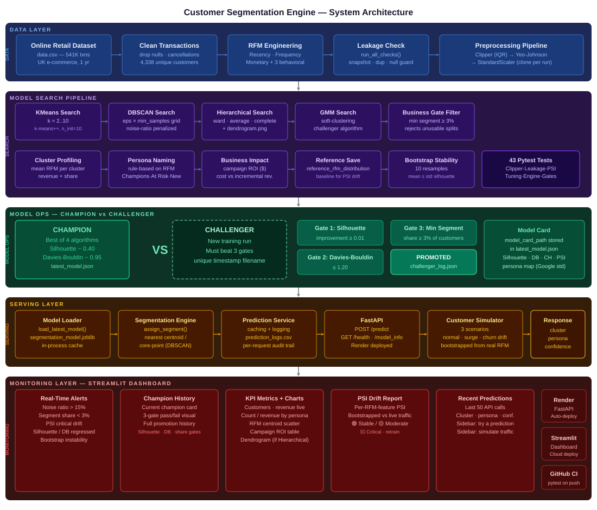
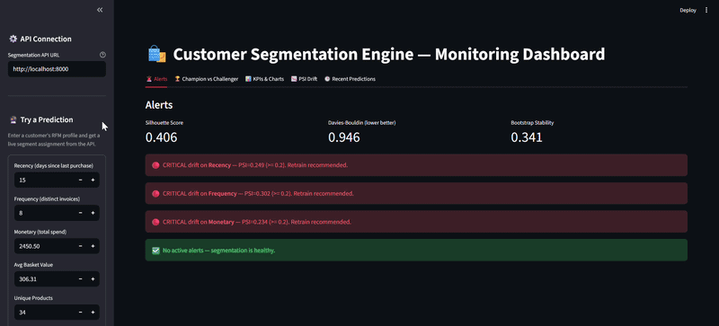
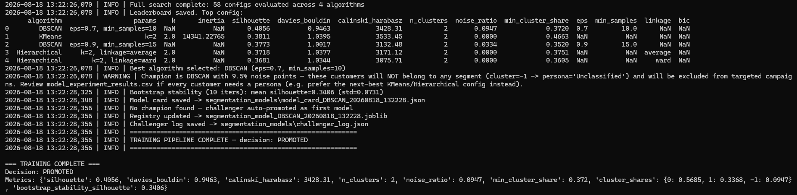

# 🛍️ Customer Segmentation Engine


> **Domain:** E-Commerce / BFSI / Consulting &nbsp;·&nbsp; **Problem Type:** Unsupervised Clustering (RFM + KMeans / DBSCAN / Hierarchical / GMM) &nbsp;·&nbsp; **Dataset:** [UK Online Retail](https://www.kaggle.com/datasets/carrie1/ecommerce-data) — 541,909 transactions, 4,338 customers

An end-to-end, production-grade unsupervised ML system that segments e-commerce customers into actionable personas (**Champions, Loyal, At Risk, Big Spenders, New, Hibernating**) using RFM analysis + a 4-algorithm clustering search — built to the same MLOps standard as the portfolio's banking-grade credit-risk and fraud-detection systems: Champion-Challenger promotion, PSI drift monitoring, leakage checks, and a live FastAPI + Streamlit stack.

---

## 🧭 Why This Project Matters

Retail, BFSI, and consulting growth teams (Myntra, HDFC Bank, McKinsey-style teams) don't blast every customer with the same email — they segment first. This project reproduces that workflow end-to-end: raw transaction logs → RFM features → a governed model-selection pipeline → a served, monitored API a marketing team could actually plug a CRM into.

Unlike the portfolio's supervised projects (Fraud Detection, Credit Risk, Churn), **this is unsupervised learning** — there's no ground-truth label to score against. Every design decision here had to be adapted for that: model selection uses internal validity indices (Silhouette, Davies-Bouldin, Calinski-Harabasz) instead of F1/ROC-AUC, and the Champion-Challenger gates check segment-size usability instead of classification metrics.

---

## 🏆 Champion Model Results

*(Trained on the full 541,909-row dataset → 4,338 customers after cleaning)*

| Metric | Value |
|---|---|
| Champion Algorithm | **DBSCAN** (eps=0.7, min_samples=10) |
| Silhouette Score | **0.4056** |
| Davies-Bouldin Index | **0.9463** (lower is better) |
| Calinski-Harabasz Index | 3,428.31 |
| Clusters found | 2 (+ 9.47% noise, unassigned) |
| Bootstrap Stability | 0.3406 mean silhouette (10 resamples) |
| Total Revenue Segmented | ₹8,887,209 |
| Segments Surfaced | 3 (incl. noise bucket) |

Full leaderboard across all 4 algorithms (58 configs evaluated) is written to `segmentation_models/model_experiment_results.csv` on every training run.

---

## 🔗 Live Links

| Service | URL |
|---|---|
| API (Render) | `<add after deployment>` |
| Dashboard (Streamlit Cloud) | `<add after deployment>` |

---

## 🏗️ System Architecture



```
data/raw/data.csv (541K transactions)
        │
        ▼
 src/data_loader.py        — load + clean (drop nulls, cancellations, non-positive qty/price)
        │
        ▼
 src/preprocessing.py      — RFM engineering (Recency, Frequency, Monetary + behavioral)
        │
        ▼
 src/leakage_check.py      — snapshot leakage / duplicate-customer / null-value checks
        │
        ▼
 src/preprocessing.py      — Clipper (IQR) → Yeo-Johnson → StandardScaler
        │
        ▼
 src/model_tuning.py       — KMeans + DBSCAN + Hierarchical (+ dendrogram) + GMM search
        │
        ▼
 src/metrics.py            — Silhouette / Davies-Bouldin / Calinski-Harabasz + bootstrap stability
        │
        ▼
 src/evaluation.py         — cluster profiling → persona naming → business impact ($ ROI)
        │
        ▼
 src/model_loader.py       — Champion-Challenger (3-gate promotion) → segmentation_models/
        │
        ├──► serving/segmentation_api.py       (FastAPI: /predict /health /model_info)
        └──► monitoring/monitoring_dashboard.py (Streamlit: alerts, champion-challenger, KPIs, PSI drift, live predictions)
```

---

## 📸 Dashboard Screenshots

| | |
|---|---|
| **Full Dashboard** |  |
| **Segment KPIs** |  |
| **Revenue & Segment Centroids** |  |
| **Business Impact / Campaign ROI** |  |
| **Champion vs Challenger — Promotion History** |  |
| **Feature Drift (PSI)** |  |
| **Recent Predictions** |  |

> Note: `feature_drift(psi).png` has parentheses in the filename, which markdown link syntax can't parse literally — the embed above uses `%28`/`%29` URL-encoding to work around it. Renaming the file to `feature_drift_psi.png` (and updating the link) is cleaner if you ever re-export it.

## 🎬 System Demo



## 📊 Reports

| | |
|---|---|
| **Training Run Summary** |  |
| **Live Traffic Simulation** |  |
| **Test Coverage** |  |

---

## 📁 Project Structure

```
Customer-Segmentation-Engine/
├── .github/workflows/ci.yml        # GitHub Actions — pytest on push
├── data/
│   └── raw/                        # sample dataset included; swap in the full Kaggle CSV as data.csv
├── docs/
│   ├── architecture/                # system_architecture.svg
│   ├── gifs/                        # system_demo.gif
│   ├── reports/                     # training_model_summary.png, simulation.png, test_coverage.png
│   └── screenshots/                 # dashboard_full_ui.png + 6 more
├── logs/                            # prediction_logs.csv (created at runtime)
├── monitoring/
│   └── monitoring_dashboard.py      # Streamlit — 5 tabs + sidebar prediction/simulation
├── notebooks/
│   └── segmentation_eda.ipynb       # 25-step professional EDA + dendrogram
├── scripts/
│   ├── train_model.py
│   ├── run_api.py
│   ├── run_dashboard.py
│   └── run_simulation.py
├── segmentation_models/             # trained artifacts (created at runtime)
├── services/
│   └── prediction_service.py        # caching + prediction logging
├── serving/
│   └── segmentation_api.py          # FastAPI: /predict /health /model_info
├── simulation/
│   └── customer_simulator.py        # 3 scenarios, bootstrapped from real RFM distribution
├── src/
│   ├── config.py                    # thresholds, gates, paths
│   ├── data_loader.py                # load + clean transaction log
│   ├── preprocessing.py              # Clipper, RFM engineering, scaling pipeline
│   ├── model_tuning.py               # KMeans / DBSCAN / Hierarchical / GMM grid search
│   ├── metrics.py                    # Silhouette, DB, CH, PSI, bootstrap stability
│   ├── evaluation.py                 # cluster profiling, persona naming, business impact
│   ├── leakage_check.py              # snapshot/duplicate/null leakage checks
│   ├── model_loader.py               # Champion-Challenger 3-gate promotion system
│   ├── model_card.py                 # Google Model Cards standard JSON
│   ├── segmentation_engine.py        # inference: assign new customer to segment
│   └── training_pipeline.py          # orchestrates the full pipeline
├── tests/
│   ├── conftest.py                   # OMP_NUM_THREADS fix for sklearn/Windows
│   ├── fixtures/                     # synthetic sample_retail.csv for CI
│   └── test_pipeline_core.py         # 43 pytest tests
├── docker-compose.yml
├── Dockerfile
├── Dockerfile.dashboard
├── render.yaml
├── requirements.txt
├── requirements_api.txt
├── requirements_dashboard.txt
└── runtime.txt
```

---

## 🚀 Quickstart

### 1. Setup
```bash
git clone https://github.com/narendrakalam/Customer-Segmentation-Engine.git
cd Customer-Segmentation-Engine
pip install -r requirements.txt
```

### 2. Data
A sample dataset is already included under `data/` for a quick smoke-test run. For real, reproducible metrics, download [Online Retail](https://www.kaggle.com/datasets/carrie1/ecommerce-data) from Kaggle and place it at `data/raw/data.csv`.

### 3. Train
```bash
python scripts/train_model.py
```
Runs the full pipeline: load → clean → RFM → leakage checks → preprocess → KMeans/DBSCAN/Hierarchical/GMM search → persona assignment → champion-challenger promotion. Artifacts land in `segmentation_models/`.

### 4. Serve the API
```bash
python scripts/run_api.py
```
```bash
curl -X POST http://localhost:8000/predict \
  -H "Content-Type: application/json" \
  -d '{"Recency": 12, "Frequency": 8, "Monetary": 2450.50, "AvgBasketValue": 306.31, "UniqueProducts": 34, "Tenure": 210}'
```

### 5. Run the monitoring dashboard
```bash
python scripts/run_dashboard.py
```
The sidebar has a **manual prediction form** (test a customer instantly) and a **"Simulate Live Traffic"** button (no CLI needed) alongside the 5 tabs (Alerts, Champion vs Challenger, KPIs & Charts, PSI Drift, Recent Predictions).

### 6. Simulate traffic from the CLI (optional)
```bash
python scripts/run_simulation.py --scenario churn_risk_drift --n 100 --send-api
```

### 7. Run tests
```bash
pytest tests/ -v --cov=src --cov-report=term-missing
```

---

## 🐳 Docker

```bash
docker compose up --build      # API on :8000, Dashboard on :8501
docker compose up api          # API only
docker compose up dashboard    # Dashboard only
```

## ☁️ Deployment

`render.yaml` deploys the FastAPI service to [Render](https://render.com). `.github/workflows/ci.yml` runs the full 43-test pytest suite on every push/PR via GitHub Actions.

---

## 🔬 Technical Approach

| Component | Standard Applied |
|---|---|
| RFM Engineering | Fixed `snapshot_date` (max invoice + 1 day) → Recency/Frequency/Monetary + AvgBasketValue/UniqueProducts/Tenure |
| Outlier Handling | `Clipper` (IQR, fold=1.5) — fit on train, applied at inference |
| Scaling | Yeo-Johnson power transform → StandardScaler (`clone()` per run, no shared fitted state) |
| Model Search | KMeans (k=2-10) · DBSCAN (eps×min_samples grid) · Hierarchical (ward/average/complete + dendrogram) · GMM — 58 configs ranked by Silhouette |
| Business Usability Gate | Best-silhouette config only wins if its smallest segment ≥ 3% of customers (prevents unusable micro-segments) |
| Champion-Challenger | 3 gates: Silhouette improvement ≥0.01 · Davies-Bouldin ≤1.20 · min segment share ≥3% — versioned, timestamped model files so a rejected challenger can never overwrite the champion |
| Drift Monitoring | Edge-based PSI per RFM feature, live traffic bootstrapped from the real training distribution vs training reference |
| Leakage Checks | Snapshot leakage, duplicate-customer leakage, null/negative-value checks — run before every training call |
| Explainability | Model Card JSON (Google Model Cards standard), persona rule engine documented in `src/evaluation.py` |
| Experiment Tracking | `segmentation_models/model_experiment_results.csv` — every config from every run, MLflow-ready |

---

## 🏆 Champion-Challenger — 3-Gate Promotion (adapted for unsupervised learning)

Since clustering has no ground-truth label, gates use internal validity indices instead of F1/ROC-AUC:

| Gate | Condition |
|---|---|
| 1. Silhouette improvement | `challenger_silhouette − champion_silhouette ≥ 0.01` |
| 2. Davies-Bouldin index | `challenger_DB ≤ 1.20` |
| 3. Minimum segment size | smallest segment ≥ 3% of customer base |

Example from an actual retrain (`segmentation_models/challenger_log.json`):
```
CHAMPION vs CHALLENGER
  Champion  : segmentation_model_DBSCAN_v1.joblib             sil=0.4056  DB=0.9463
  Challenger: segmentation_model_DBSCAN_20260818_131447.joblib sil=0.4056  DB=0.9463
CHALLENGER REJECTED — champion retained
   Reason: Gates failed: silhouette improvement +0.0000 < 0.01
```
Rejected challengers' `.joblib`/model-card files are deleted automatically to keep `segmentation_models/` clean — only the champion and its full metrics history persist.

---

## 💰 Business Impact — Campaign ROI by Segment

*(From an actual run on the full dataset — `segmentation_models/business_impact.csv`)*

| Persona | Customers | Campaign Cost | Expected Incremental Revenue | ROI | Action |
|---|---|---|---|---|---|
| Champions | 2,466 | ₹1,849.50 | ₹1,641,609.70 | **887.6x** | Loyalty / early-access campaign |
| Champions (secondary cluster) | 411 | ₹308.25 | ₹206,438.95 | 669.7x | Loyalty / early-access campaign |
| New Customers | 1,461 | ₹1,095.75 | ₹0 | 0x | Standard broadcast / no targeted spend |

---

## 📈 Monitoring Dashboard — 5 Sections

| Tab | What it shows |
|---|---|
| 🚨 Alerts | Silhouette/DB/stability metrics, noise-ratio + min-segment-share + PSI critical-drift alerts |
| 🏆 Champion vs Challenger | Current champion card + full promotion history table |
| 📊 KPIs & Charts | Customer count & revenue by persona, RFM centroid scatter, campaign ROI table, dendrogram (when Hierarchical is champion) |
| 📉 PSI Drift | Per-RFM-feature PSI vs training reference, 🟢/🟡/🔴 status |
| 🕒 Recent Predictions | Last 50 `/predict` calls + live persona mix pie chart |

Sidebar (always visible): configurable API URL, a manual "Try a Prediction" form, and a "Simulate Live Traffic" button (3 scenarios) — no CLI needed to demo the full loop.

---

## 🧪 Testing

**43 pytest tests**, all passing (`pytest tests/ -v --cov=src`):

| Category | Tests |
|---|---|
| Data Loader | 7 |
| RFM Engineering | 5 |
| Leakage Checks | 6 |
| Preprocessing | 4 |
| Model Tuning & Metrics (incl. Hierarchical/PSI/bootstrap) | 11 |
| Evaluation (scoring, profiling, personas, ROI) | 4 |
| Champion-Challenger | 3 |
| Segmentation Engine (inference) | 3 |
| **Total** | **43** |

`tests/conftest.py` sets `OMP_NUM_THREADS=1` before scikit-learn loads, per scikit-learn's own recommendation — avoids a known KMeans/MKL memory-leak warning on Windows.

---

## ⚠️ Known Limitations

- **DBSCAN noise persona edge case**: the current champion is DBSCAN, and ~9.5% of customers fall into the noise cluster (label `-1`). At inference, `segmentation_engine.py` is designed to label these as `"Unclassified"` — but the persona rule engine in `evaluation.py` runs on *all* cluster rows produced at training time, including the noise cluster's centroid, which can assign it a real persona label (e.g. "Champions") instead. This means the "9.5% of customers get Unclassified" guarantee mentioned during training doesn't fully hold today — worth a follow-up fix (special-case cluster `-1` in `assign_personas()`) before treating noise-cluster customers as a real target segment in a live campaign.
- **Small-sample PSI sensitivity**: PSI values can look inflated on very small customer bases (the bundled CI fixture has only 120 synthetic customers) — this is a known quantile-binning artifact, not a bug; it settles down at the real dataset's scale (4,338 customers).
- **AgglomerativeClustering has no native `.predict()`**: new customers are assigned via nearest-centroid to precomputed cluster means, not the algorithm's original linkage — a standard, documented workaround, but worth knowing if you inspect `segmentation_engine.py`.

---

## 🔗 Related Portfolio Projects

| Project | Domain | Type | Key Metric |
|---|---|---|---|
| Credit Card Fraud Detection | BFSI | Classification | F1 = 0.8962 (ExtraTrees) |
| Credit Risk Prediction | BFSI | Classification | F1 = 0.9741, ROC-AUC = 0.9991 (LightGBM) |
| Customer Churn Prediction | BFSI | Classification | — |
| Store Sales Forecasting | Retail | Time Series | Kaggle competition |
| **Customer Segmentation Engine** | **E-Commerce / BFSI** | **Unsupervised Clustering** | **Silhouette = 0.4056 (DBSCAN)** |

---

## 👤 Author

**Narendra Kalam** — MSc Computer Science (Gold Medalist, NASSCOM Full Stack Data Science + AI)
Building a 20+ project industry-standard ML portfolio across Supervised ML, Time Series, NLP, Computer Vision, RNN, ANN, Unsupervised ML, and Recommendation Systems.

## 📄 License

MIT — see `LICENSE` (add one at the repo root if it isn't there yet; it wasn't present in the current folder listing).